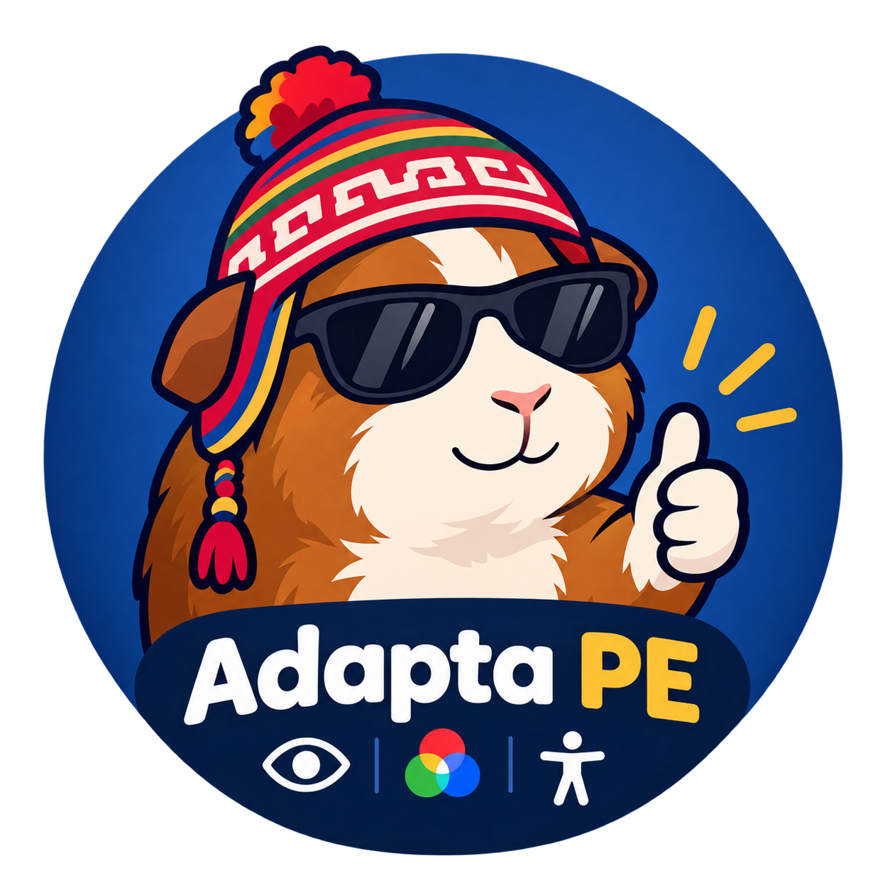

<p align="center">
  
</p>

# Adapta PE Base para macOS

Adapta PE Base es una aplicación nativa de escritorio en SwiftUI para usar el Mac con voz, lectura de controles y cursor por cámara. Está pensada para quien necesita adaptar el manejo del escritorio a su movilidad: permite ajustar postura, velocidad, temblor y espera de clic. Puedes activar sólo las funciones que necesites.

Esta es la **edición completa de escritorio para macOS**, independiente de las extensiones. Incluye tres modos de cámara, TalkBack, siete filtros de pantalla, mascotas opcionales y panel flotante. Los comandos y el control corporal funcionan sin una API key. La IA externa es voluntaria; no incluye un modelo generativo local ni una suscripción.

Requiere **macOS Sonoma 14.0 o posterior**. El proyecto está destinado a **Intel (`x86_64`) y Apple Silicon (`arm64`)**: no fija `ARCHS` ni excluye arquitecturas; usa las arquitecturas estándar de Xcode. Debug tiene `ONLY_ACTIVE_ARCH = YES`, por lo que una compilación de desarrollo no demuestra que el resultado sea universal. Tampoco acredita funcionamiento en todos los Mac compatibles.

Si sólo necesitas voz, filtros, mascotas y lectura manual, consulta [Adapta PE Lite para macOS](https://github.com/TheAlejo160/Adapta-PE-Lite-MacOS), que tiene su propio proyecto y no incorpora cámara ni TalkBack automático.

## Instalar en tu Mac

### Desde un DMG

En el entorno de este proyecto existe un archivo histórico llamado `Instalador_Adapta_PE.dmg`. No forma parte del flujo reproducible de compilación ni se acredita aquí que contenga las fuentes actuales. Consulta las [descargas del sitio oficial](https://www.adaptape.cc) para comprobar qué paquete se ofrece; clonar el repositorio no garantiza descargar un instalador.

Si recibes un DMG de una fuente que reconoces:

1. Ábrelo y copia la aplicación a **Aplicaciones**.
2. Abre la copia de Aplicaciones, en lugar de ejecutarla dentro de la imagen.
3. Si macOS bloquea la apertura por desarrollador no identificado o falta de notarización, intenta abrirla una vez y entra en **Ajustes del Sistema → Privacidad y seguridad → Abrir de todos modos** (también puede aparecer como **Abrir igualmente**). Confirma únicamente si confías en ese archivo.
4. Concede después los permisos de las funciones que vayas a usar.

Ese permiso de apertura es distinto de Accesibilidad. No hace falta desactivar Gatekeeper. Si el aviso indica malware, archivo dañado o una restricción de tu organización, verifica la descarga o consulta al administrador; no lo trates como el mismo bloqueo. Este README no certifica firma, notarización ni integridad del DMG histórico.

### Desde este repositorio con Xcode

Necesitas Xcode completo y sus herramientas de línea de comandos seleccionadas. El proyecto registra **Xcode 27.0** y utiliza grupos de archivos sincronizados; usa Xcode 27 como referencia. No se ha establecido aquí la versión anterior más antigua capaz de compilarlo. No requiere Python, Node, npm ni paquetes Swift externos.

```sh
git clone https://github.com/TheAlejo160/Adapta-PE-MacOS-Intel-Apple-Silicon-.git Adapta-PE-macOS
cd Adapta-PE-macOS
xcodebuild -version
open Adapta-PE.xcodeproj
```

En Xcode:

1. Selecciona el esquema **Adapta-PE** y el destino **My Mac**.
2. En el target **Adapta-PE → Signing & Capabilities**, sustituye el equipo del autor por tu propio equipo si vas a ejecutar una compilación firmada. La firma automática del repositorio no da acceso a su cuenta.
3. Ejecuta **Product → Run**. Autoriza los permisos para esa copia de la aplicación.

También puedes compilar y abrir la app con el script existente, después de configurar la firma:

```sh
./script/build_and_run.sh --verify
```

El script cierra la instancia anterior de Base, compila Debug en una carpeta temporal y abre `Adapta-PE.app`. `--verify` sólo comprueba que el proceso siga presente después de un segundo; no prueba voz, cámara ni accesibilidad. Sin argumentos compila y abre; `--debug` compila y abre el proyecto en Xcode; `--logs` muestra logs del proceso y `--telemetry` los del subsistema de la app.

Para una comprobación de compilación local sin firma, puedes usar el comando de la sección [Desarrollo y pruebas](#desarrollo-y-pruebas). No genera una distribución notarizada. Para mantener una copia local Release, configura primero tu firma y ejecuta:

```sh
xcodebuild -project Adapta-PE.xcodeproj -scheme Adapta-PE \
  -configuration Release -derivedDataPath build/base build
mkdir -p "$HOME/Applications"
ditto build/base/Build/Products/Release/Adapta-PE.app "$HOME/Applications/Adapta-PE.app"
open "$HOME/Applications/Adapta-PE.app"
```

Cierra la copia anterior desde la barra de menú antes de sustituirla. Mantener ubicación y firma estables ayuda a conservar los permisos de macOS. Publicar para otras personas requiere revisar la firma de distribución y la notarización por separado.

## Permisos: concede sólo los que necesites

En **Ajustes del Sistema → Privacidad y seguridad**, busca la copia de Adapta PE que ejecutas. El nombre de Grabación de pantalla puede variar entre versiones de macOS.

| Permiso | Cuándo se usa | Dónde revisarlo |
| --- | --- | --- |
| Micrófono | Al encender **Voz**. | **Micrófono**. |
| Reconocimiento de voz | Para convertir el audio en órdenes con Speech de Apple. | **Reconocimiento de voz**. |
| Accesibilidad | Cursor, clics, teclado, campos, menús y lectura de controles AX. | **Accesibilidad**; la app ofrece **Permitir control del escritorio**. |
| Cámara | Al encender **Cursor con cámara**. | **Cámara**. No se necesita para voz o lectura manual. |
| Grabación de pantalla | Filtros y captura explícita para IA. | **Grabación de pantalla**, o **Grabación de pantalla y audio del sistema**. Los filtros no capturan audio. |
| Automatización | Control de pestañas y ventanas y búsqueda contextual en Safari, Chrome, Brave o Edge mediante Apple Events. | **Automatización → Adapta PE** y el navegador solicitado; aparece tras una petición. |

En **Control → Dispositivos y preferencias → Actualizar dispositivos y permisos** puedes renovar el estado. Hay botones específicos cuando se deniega cámara, micrófono o reconocimiento. Si macOS solicita reiniciar la app tras un cambio, sal desde su barra de menú y vuelve a abrirla.

El proyecto genera su Info.plist con las descripciones `NSCameraUsageDescription`, `NSMicrophoneUsageDescription`, `NSSpeechRecognitionUsageDescription` y `NSAppleEventsUsageDescription`. Activa hardened runtime, acceso a cámara/audio y Apple Events; no utiliza App Sandbox. Estas capacidades de firma no sustituyen el consentimiento de macOS.

## Primera sesión: voz y una orden sencilla

1. Abre **Control → Dispositivos y preferencias** y elige **Micrófono**. La selección predeterminada sigue al dispositivo del sistema.
2. En **Nombre para llamar al asistente**, deja `computadora` o escribe un nombre propio, por ejemplo `Máquina Azul`.
3. Enciende **Voz** y concede Micrófono y Reconocimiento de voz. Espera el estado que invita a decir el nombre.
4. Di **«Computadora, por favor abre Safari»**. Si elegiste otro nombre, úsalo en su lugar. La interfaz muestra **Escuché:** y la respuesta.
5. Puedes decir sólo el nombre y dar la orden en los siguientes **8 segundos**. Fuera de esa espera, vuelve a llamar al asistente.

El nombre predeterminado acepta «Computadora», «Computadoras» y «Computador». Un nombre personal tiene sus propias coincidencias: elegir «Asistente» no mantiene esos alias. Se comparan acentos y espacios equivalentes, conservando el contenido de la orden.

La implementación actual reconoce órdenes en **español**. Busca reconocimiento local disponible en `es-PE`, `es-ES` o `es-MX`. Si no lo encuentra, muestra el motivo. **Permitir reconocimiento de Apple por red** está apagado por defecto: al encenderlo autorizas que Apple pueda procesar audio por red. Esto es independiente de la IA externa. La guía [AdaptaPE.md](AdaptaPE.md) incluye objetivos de otras plataformas y seis idiomas; no todos están implementados en esta app.

### Abrir apps, sitios y navegar

Precede estas órdenes con tu nombre de activación:

- **«Abre Zoom»**, **«ejecutar Visual Studio Code»**, **«abre Safari en el segundo monitor»**. La app debe estar instalada. Los monitores se enumeran en Dispositivos y preferencias.
- **«Abre YouTube»**, **«busca movilidad en Wikipedia»**, **«abre Google en nueva pestaña»**.
- **«Nueva pestaña»**, **«abre una nueva ventana de Chrome»**, **«abre Chrome en nueva ventana»**, **«cierra esta pestaña»**, **«atrás»**, **«adelante»**, **«recarga»**.
- **«Siguiente pestaña»**, **«anterior pestaña»**, **«aumenta zoom»**, **«reduce zoom»**, **«zoom normal»**, **«baja la página»**, **«sube»**, **«inicio»**, **«final»**.
- **«Guardar»**, **«guardar como»**, **«imprimir»**, **«Spotlight»**, **«Mission Control»**, **«mostrar escritorio»**, **«pantalla completa»**.
- **«Presiona comando shift N»**, **«atajo control option arriba»**, **«campo siguiente»**, **«campo anterior»**, **«enter»**, **«copia»**, **«pega»**.

Los alias de aplicaciones se resuelven localmente; errores breves de nombre sólo se aceptan con una coincidencia única. Un empate pide un nombre más preciso. Los atajos y las acciones dependen de la app activa y de lo que permita macOS; el navegador debe estar activo para sus órdenes específicas.

### Dictar, elegir campos y activar controles

1. Activa una aplicación con un campo editable y concede Accesibilidad.
2. Di **«Computadora, escribe Hola, José»**. Se conserva el texto reconocido, con mayúsculas, acentos y signos; no es un modo de dictado continuo sin órdenes.
3. Para un campo concreto, prueba **«enfoca Nombre»** o **«escribe Hola, José en el campo Nombre»**. **«Borra el campo»** elimina su contenido y **«selecciona el texto Buenos días»** intenta seleccionar esa cadena en el campo activo.
4. Di **«selecciona Contacto»** y después **«pulsa lo seleccionado»**, o directamente **«clic en Contacto»**. También admite **«presionar el botón Contacto»**, **«dar anticlick»** y **«clic derecho»**.

En **Ayuda**, **Buscar campos de texto** equivale a **«muestra campos»** y **Acciones de la app activa** a **«muestra comandos»**. Para un menú expuesto por la app, prueba **«ejecuta la acción Exportar PDF»**.

Si hay varias opciones, el panel presenta páginas de hasta **seis elecciones numeradas**. Responde **«la segunda»**, **«número dos»** o un nombre único; también puedes pulsar el botón. **Siguiente** muestra más y **Cancelar** abandona la elección. Caduca a los **45 segundos** y se cancela si cambia la aplicación; antes de actuar se comprueba también la ventana de destino.

La lectura, el foco y la activación dependen de los controles que cada aplicación publique mediante Accesibilidad (AX). No se garantiza acceso a lienzos, juegos o controles sin nombres accesibles. Los campos protegidos de contraseña se excluyen de lectura y dictado. Si cambias de campo o aplicación durante el dictado, se detiene para evitar escribir en otro destino.

### Leer con TalkBack y lectura manual

En **Lectura y filtros**, activa **Leer en voz alta el elemento bajo el cursor** y mantén el puntero sobre un control. Funciona tanto con ratón físico como con cámara. Es TalkBack de Adapta PE basado en AX; no reemplaza el lector VoiceOver del sistema.

**Leer ventana activa** o **«lee la pantalla»** leen el texto accesible de la ventana; no hacen OCR ni envían una imagen a una IA. **«Leer el botón Contacto»** pide un elemento concreto. Usa **Detener lectura** o **«Computadora, silencio»** para interrumpir. Durante la salida hablada se filtran órdenes ordinarias para evitar el eco; **«Computadora, detener todo»** permite parar la asistencia.

## Cursor con cámara: calibrar antes de usar

En **Control → Adaptar a mi movimiento**, elige **Control con**:

- **Cabeza / torso**: mantén una postura cómoda mientras aprende el reposo. Requiere al menos cuatro muestras distintas y 900 ms de estabilidad. La cabeza usa rostro/nariz y giro, con respaldo corporal.
- **Brazos, manos o puños**: parte de la primera posición fiable como reposo. Desplaza ligeramente la zona visible y mantén la dirección; volver al inicio detiene el cursor. Usa muñeca y respaldo de muñecas/codos, sin elegir hombros como control de este modo.
- **Zona con textura**: rastrea un detalle que se mueve en la imagen, sin clasificar anatomía. Necesita textura visible; superficies uniformes, patrones repetidos y oclusiones pueden impedir el seguimiento. Tras una pérdida prolongada necesita adquirir otro detalle.

Luego:

1. Elige **Cámara** en Dispositivos y preferencias. Autoriza Cámara y Accesibilidad.
2. Enciende **Cursor con cámara**. La vista muestra zona segura verde, punto blanco y progreso del clic.
3. Pulsa **Calibrar** si cambias de postura. Ajusta **Velocidad**, **Reducir temblores** y **Adaptar a movimientos pequeños** a tu movimiento real.
4. Si deseas clic por permanencia, activa **Clic al mantener la postura** y ajusta **Espera de clic** entre 0,4 y 3 segundos. Sal del anillo de atracción para armarlo, vuelve a reposo sobre el mismo destino y espera. Produce un clic por entrada; descansar no debe repetirlo.
5. Usa **Pausar cursor** / **Reanudar cursor**, o mueve el ratón físico: éste pausa el control por cámara durante dos segundos y reinicia la referencia. **Detener todo** apaga la asistencia.

Por voz: **«control cabeza»**, **«control manos»**, **«control brazo izquierdo»**, **«control zona libre»**, **«calibrar cursor»**, **«activar temblor»**, **«movimientos pequeños»**, **«cursor más lento»**, **«pausar cursor»**, **«reanudar cursor»**, **«siguiente clic derecho»** y **«cancelar clic»**.

Pérdidas, pausas, calibración, cambios de fuente y huecos de más de 200 ms desarman el clic. La atracción a controles accesibles cercanos es suave y acotada; no arma el clic por sí sola. Vision aporta puntos 2D: no se atribuye profundidad 3D ni se promete precisión universal con amputaciones o movilidad reducida. La calibración y los gestos deben probarse con cada persona y equipo.

## Color, mascotas y panel flotante

En **Lectura y filtros → Filtro de pantalla** elige Protanomalía, Protanopía, Deuteranomalía, Deuteranopía, Tritanomalía, Tritanopía o Acromatopsia. Concede Grabación de pantalla y espera el estado **Activo**; **Quitar filtro** lo retira. También funcionan **«filtro deuteranopía»** y **«quitar filtro»**.

Son matrices de simulación de color, no una corrección médica del daltonismo. La composición es local por monitor, con ScreenCaptureKit y Core Image. La capa espera el primer cuadro antes de mostrarse; una entrega tardía no debe reaparecer después de detenerla. Adapta PE queda fuera del filtro para conservar el acceso a sus controles. Contenido protegido, escritorios seguros y algunos juegos o ventanas pueden impedir captura o superposición; no se eluden esas restricciones.

En **Mascota → Tu mascota**, elige **Tinku · gallito**, **Cuchu · cuy**, **Yati · llama** o **Sin mascota** (valor inicial). **Saludar**, **Dormir** y **Despertar** controlan sus estados. Arrastra su nombre entre pantallas, usa **Mover con teclas** y las flechas, termina con Escape, o pulsa **Otro monitor**. El dibujo deja pasar los clics; se recuerda su posición. La animación respeta movimiento reducido y suspensión, y descansa tras 90 segundos sin interacción. Dormir manualmente exige Despertar.

Por voz, después de llamar al asistente: **«mascota Cuchu»**, **«elige mascota Tinku»**, **«mascota Yaty»**, **«oculta mascota»**, **«saluda mascota»**, **«duerme mascota»** y **«despierta mascota»**. Buscar o dictar esos nombres conserva el texto.

Pulsa **Usar panel** para mantener controles compactos sobre otras apps. Incluye **Voz**, **Cursor**, transcripción, respuesta, elecciones y **Detener todo**. En **Opciones** puedes elegir mascota, filtro, esquina y monitor. Desmarcar **Mostrar cámara** oculta la vista previa; no apaga el cursor. **Abrir ajustes**, con el icono de engranaje, vuelve a la ventana principal.

El título del panel se arrastra o se mueve con flechas al enfocarlo. **Mover mascota y panel juntos** coloca la mascota encima y permite mover ambos. También admite **«une mascota al panel»**, **«separa mascota del panel»**, **«panel esquina superior izquierda»** y **«mueve el panel a la esquina inferior derecha»**.

### Cerrar ajustes y continuar en segundo plano

Cerrar la ventana mantiene la app activa. En la barra de menú, **Abrir ajustes**, **Mostrar panel flotante**, **Activar voz**, **Activar cursor**, **Pausar cursor** y **Detener todo** permiten continuar. **Salir de Adapta PE** termina el proceso.

**Iniciar al encender el Mac**, en Dispositivos y preferencias, registra el inicio de sesión. El primer uso comienza con módulos apagados; después se recuerdan preferencias y módulos activos y sólo se restauran permisos ya concedidos. **Detener todo** deja los módulos apagados para el siguiente inicio. Dormir libera capturas; despertar intenta restaurar lo que estaba activo. El atajo **⌘⇧.** ejecuta Detener todos los módulos cuando lo recibe la app.

## IA externa opcional y privacidad

Para usar un proveedor compatible con `chat/completions`:

1. En **IA opcional**, enciende **Activar IA con mi API key**.
2. Completa **Endpoint HTTPS de chat/completions** y **Modelo disponible en tu proveedor**.
3. Introduce **API key personal** y pulsa **Guardar en Llavero**. Puedes retirarla con **Eliminar clave**.
4. Di **«Computadora, pregunta a la IA …»**. Sólo se envía la consulta explícita; las órdenes desconocidas no se envían automáticamente. **Cancelar consulta** interrumpe la petición pendiente.

Se admite HTTP únicamente en loopback real (`localhost`, `127.0.0.0/8` o `::1`); los destinos remotos requieren HTTPS. Cambiar el endpoint cancela la consulta, borra la clave anterior del Llavero y revoca el permiso de envío de pantalla. Si no puede borrar la clave, conserva el endpoint anterior. Guarda la clave del nuevo destino y vuelve a autorizar la pantalla si la necesitas. Las respuestas tienen un límite de 64 KiB y no se siguen redirecciones. Los costes y el tratamiento de datos dependen del proveedor.

**«Analiza pantalla con IA»** requiere **Permitir envío de pantalla al proveedor** durante esa sesión, un modelo con imágenes y Grabación de pantalla. Antes del envío aparece **Enviar el monitor principal completo**, con **Enviar** y **Cancelar**: oculta datos privados antes de confirmar. **«Lee la pantalla»** siempre sigue usando AX local.

Cámara, seguimiento, TalkBack y filtros se procesan localmente. La app no guarda imágenes, posturas, grabaciones ni transcripciones; lo mostrado vive en memoria. Preferencias, dispositivos, posición y módulos activos sí se recuerdan en UserDefaults. La clave se guarda en Llavero, no en el repositorio. El reconocimiento de Apple por red y la IA externa son dos salidas de datos diferentes y requieren sus respectivas opciones.

## Si algo no funciona en macOS

| Síntoma | Qué revisar |
| --- | --- |
| Xcode falla por firma o equipo no disponible. | Selecciona tu equipo en Signing & Capabilities. Para comprobar sólo compilación usa `CODE_SIGNING_ALLOWED=NO`; eso no valida ejecución ni distribución. Comprueba `xcodebuild -version` y que esté seleccionado Xcode completo. |
| La voz queda apagada o indica permiso denegado. | Revisa Micrófono y Reconocimiento de voz, selecciona el dispositivo correcto y pulsa Actualizar dispositivos y permisos. Comprueba si otra app ocupa el dispositivo. |
| «Español local no disponible». | Revisa los recursos de dictado de español del Mac; si aceptas el procesamiento de Apple por red, activa su opción explícita. No se sustituye silenciosamente por una API generativa. |
| Escucha, pero no ejecuta. | Mira Escuché:, usa la palabra personal correcta y una orden de ejemplo. Tras decir sólo el nombre hay ocho segundos. Comprueba Accesibilidad y la app de destino. |
| El dictado no escribe o se detiene. | Enfoca un campo editable accesible. Las contraseñas están excluidas; cambiar de campo o ventana puede cancelar la acción. Prueba muestra campos. |
| No controla pestañas o sitios en el navegador. | Activa Safari, Chrome, Brave o Edge y revisa Automatización para ese navegador. Una app sin AX limita menús, lectura y selección. |
| Cámara ausente o cursor quieto. | Revisa Cámara y Accesibilidad, el selector y el estado Pausado. Actualiza dispositivos tras desconectar una cámara. Recalibra; en manos/textura empieza con movimiento leve y detalle visible. |
| El cursor se pausa al tocar el ratón. | Es intencional: espera dos segundos y restablece una postura estable, o usa Reanudar cursor si lo pausaste manualmente. |
| No se produce el clic por permanencia. | Activa Clic al mantener la postura, sal del anillo, vuelve al mismo destino y espera. Una pérdida o cambio de destino desarma el clic; no insiste mientras permaneces en reposo. |
| TalkBack no lee un control. | Revisa Accesibilidad y que el control publique texto AX. La lectura manual no realiza OCR. Prueba VoiceOver o el cursor si esa app no expone controles. |
| El filtro queda preparando o no cubre una app. | Revisa Grabación de pantalla y reinicia si macOS lo solicita. Prueba Quitar filtro y vuelve a activarlo. Contenido protegido o presentación exclusiva pueden impedirlo; no hay garantía sobre esas superficies. |
| Cerrar la ventana no apaga micrófono/cámara. | Cerrar ajustes mantiene la asistencia. Pulsa Detener todo o Salir de Adapta PE desde la barra de menú. |
| La IA devuelve error HTTP, clave ausente o respuesta incompatible. | Revisa endpoint completo, modelo, clave, cuota y compatibilidad chat/completions. Cambiar endpoint borra la clave anterior. Un modelo sólo de texto no puede analizar imágenes. |

Para diagnóstico, `./script/build_and_run.sh --logs` recompila y abre la app antes de mostrar logs. En Xcode, la consola se abre con **⇧⌘Y**. Los logs propios de voz usan `pe.adapta.desktop`, categoría `voice`, sin texto dictado ni grabaciones. Avisos como `AddInstanceForFactory` o ViewBridge también pueden proceder de servicios del sistema; no demuestran por sí solos el fallo de una orden.

## Cómo funciona este proyecto

La voz sigue **AVFoundation → Speech → VoiceInputState → CommandParser → ActionManager → AX / CGEvent / Apple Events**. El parser prepara cortesía y variantes españolas, pero conserva el contenido de dictado, selección y consultas. «Por favor abre Safari», «quiero que abras Safari» y «ábrame Safari» comparten intención. Las partículas ambiguas finales «pe» y «pues» sólo se retiran con coma previa, para conservar nombres como Adapta PE.

El cursor sigue **cámara → Vision o correlación de textura → GestureState / KineticState → movimiento y clic**. La vista previa usa `AVCaptureVideoPreviewLayer`, independiente de la inferencia serial, que descarta imágenes atrasadas. La captura solicita 640×480 a 30 FPS y textura trabaja a 160×120; son parámetros solicitados, no mediciones garantizadas de rendimiento.

| Fuente | Responsabilidad |
| --- | --- |
| [Adapta_PEApp.swift](Adapta-PE/Adapta_PEApp.swift) | `AppModel`, ciclo de vida, permisos, barra de menú, memoria de sesión, reposo y panel. |
| [ContentView.swift](Adapta-PE/ContentView.swift) | Ajustes SwiftUI y `FloatingView` (está en este mismo archivo). |
| [VoiceManager.swift](Adapta-PE/VoiceManager.swift) y [VoiceInputState.swift](Adapta-PE/VoiceInputState.swift) | Audio, Speech, recuperación, activación personal y coordinación con síntesis de voz. |
| [CommandParser.swift](Adapta-PE/CommandParser.swift) y [ActionManager.swift](Adapta-PE/ActionManager.swift) | Intenciones, sitios, atajos, ejecución, elecciones y respuestas habladas. |
| [ApplicationCatalog.swift](Adapta-PE/ApplicationCatalog.swift) | Catálogo y alias de apps instaladas. |
| [DesktopAccess.swift](Adapta-PE/DesktopAccess.swift) | AX, campos, menús, foco, dictado Unicode, selección y TalkBack. Las búsquedas tienen límites de nodos y tiempo. |
| [TrackingManager.swift](Adapta-PE/TrackingManager.swift), [GestureState.swift](Adapta-PE/GestureState.swift), [KineticState.swift](Adapta-PE/KineticState.swift) y [ZoneTracker.swift](Adapta-PE/ZoneTracker.swift) | Captura, detección por modo, postura, suavizado por tiempo, textura y permanencia. |
| [ColorFilterManager.swift](Adapta-PE/ColorFilterManager.swift) | Matrices y composición local por pantalla. |
| [Mascot.swift](Adapta-PE/Mascot.swift) y [recursos de mascotas](Adapta-PE/Mascotas/) | Atlas elegido, animación, ventanas y controles. |
| [OptionalAI.swift](Adapta-PE/OptionalAI.swift) | Llavero, endpoint, peticiones explícitas, captura consentida y cancelación. |

Consulta [docs/PARIDAD.md](docs/PARIDAD.md) para equivalencias con las extensiones y límites de validación. [AdaptaPE.md](AdaptaPE.md) es una guía de portabilidad y objetivos del ecosistema; sus objetivos no son certificaciones de esta edición.

## Desarrollo y pruebas

Desde la raíz, con Xcode completo seleccionado:

```sh
# Sólo compilación Debug, sin firma de distribución.
xcodebuild -project Adapta-PE.xcodeproj -scheme Adapta-PE \
  -configuration Debug -derivedDataPath /tmp/adapta-pe-build \
  CODE_SIGNING_ALLOWED=NO build

# Pruebas de lógica de Base.
xcodebuild -project Adapta-PE.xcodeproj -scheme Adapta-PE \
  -destination 'platform=macOS' -derivedDataPath /tmp/adapta-pe-build \
  -only-testing:Adapta-PETests CODE_SIGNING_ALLOWED=NO test
```

El target `Adapta-PETests` cubre parser, activación personal, Unicode, elecciones, postura y clic con datos sintéticos, filtros y regresiones de IA con respuestas simuladas. No usa una API real ni acredita sensores físicos.

Para la interfaz, configura firma y permisos de automatización/Accesibilidad de Xcode y su runner en el Mac donde vayas a probar:

```sh
xcodebuild -project Adapta-PE.xcodeproj -scheme Adapta-PE \
  -destination 'platform=macOS' -only-testing:Adapta-PEUITests test
```

La prueba de UI recorre ajustes, panel y continuidad en segundo plano con `--uitesting`; no activa sensores ni una API real. Puede fallar antes de conectar con el runner si el entorno no está autorizado. No se presenta como aprobada por haber compilado el target.

**Estado de esta revisión documental (18 de octubre de 2026):** comandos contrastados con el proyecto, script y targets por lectura; no se ejecutaron builds, tests ni instaladores. [docs/PARIDAD.md](docs/PARIDAD.md) conserva resultados históricos y pendientes. Quedan por validar en hardware real reconocimiento hablado, cámara y gestos, permisos de una instalación limpia, Intel, varios monitores, juegos, consumo y latencia. Mínimo declarado 14.0 no significa prueba en cada versión posterior de macOS.

### Actualizar o desinstalar

Para actualizar desde fuentes, sal de la app, conserva tus cambios propios, ejecuta `git pull --ff-only`, vuelve a compilar y reemplaza tu copia local. Si cambias firma o ubicación, revisa otra vez los permisos.

Para desinstalar, desactiva **Iniciar al encender el Mac**, pulsa **Eliminar clave** si usaste IA, sal y elimina el bundle. Borrar la aplicación por sí solo no elimina preferencias ni una clave conservada en Llavero. Los instaladores generados, DerivedData, builds, logs y credenciales quedan fuera del flujo de fuentes del repositorio.

## Ediciones relacionadas y licencia

- [Extensión Adapta PE Base](https://github.com/TheAlejo160/Adapta-PE): herramientas de accesibilidad dentro del navegador.
- [Extensión Adapta PE Lite](https://github.com/TheAlejo160/Adapta-PE-Lite): edición ligera del navegador.
- [Adapta PE Lite para macOS](https://github.com/TheAlejo160/Adapta-PE-Lite-MacOS): aplicación nativa independiente.
- [Adapta PE Base para Windows](https://github.com/TheAlejo160/Adapta-PE-Win) y [Adapta PE Lite para Windows](https://github.com/TheAlejo160/Adapta-PE-Lite-Win): proyectos de escritorio para Windows.
- [Sitio oficial de Adapta PE](https://www.adaptape.cc).

Cada edición tiene sus permisos, versiones y requisitos. Un ZIP de la extensión no instala esta aplicación.

© 2026 Rodrigo Alejandro Apcho Aliaga — TheAlejo160. Fuentes y recursos se distribuyen bajo [Creative Commons Atribución-NoComercial-CompartirIgual 4.0 Internacional](LICENSE). Publicar el código no elimina sus condiciones de reutilización. Las mascotas y sus recursos se describen en [Mascotas/README.md](Adapta-PE/Mascotas/README.md).
